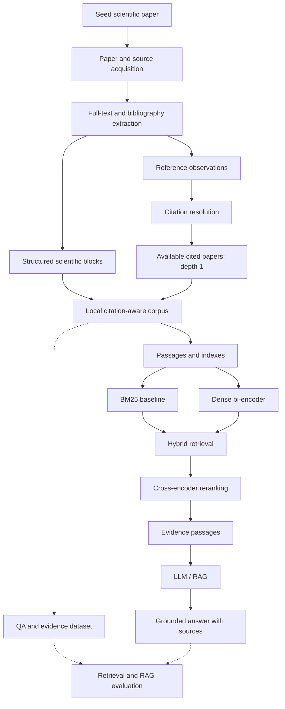

# Scientific Research Assistant

**Citation-Aware Retrieval and Evidence-Grounded RAG for Scientific Papers**

A master's annual research project exploring how to search and answer questions across a scientific paper **and the publications it cites**, while preserving verifiable evidence and its original source.

> **Project status — October 2026:** The arXiv acquisition and citation-neighborhood pilot is complete, and a provenance-preserving **LaTeX parsing research prototype** is under active development. Retrieval benchmarks, the QA dataset, RAG, and the application layer are planned; they are **not yet implemented**.

## Overview

Scientific papers rarely exist in isolation. Understanding a claim, method, or experimental result often requires following references, opening cited publications, locating relevant passages, and reconstructing their context.

Most "chat with PDF" tools focus on a single document. **Scientific Research Assistant** instead aims to construct a **local, citation-aware corpus** centered on a selected paper, so that evidence can come from both the original paper and its references.

The envisioned system will:

1. accept a scientific paper (initially an arXiv identifier or URL, with PDF ingestion as a fallback);
2. acquire and parse its full text and bibliography;
3. resolve bibliographic references to real publications, retaining unresolved cases explicitly;
4. acquire available cited papers and build a **depth-1 citation neighborhood**;
5. extract structured scientific content with traceable source positions;
6. generate and validate a question–answer–evidence dataset;
7. compare lexical, dense, hybrid, and reranked retrieval;
8. generate answers grounded in retrieved passages, with verifiable citations.

This is an **independent project**, with possible future integration into [ML Research Radar](https://github.com/KonNik88/ml-research-radar). Integration is not a dependency of the master's project.

## Problem

A typical literature-reading workflow is:

```text
read a paper
    ↓
follow a citation
    ↓
open the referenced paper
    ↓
find the relevant passage
    ↓
reconstruct the context
    ↓
return to the original paper
```

The cost increases when several cited works must be investigated. The research challenge is not just generating a fluent answer, but **finding the right scientific evidence, preserving its origin, and measuring whether the evidence supports the answer**.

## Proposed System



The diagram describes the **target architecture**, not a fully delivered application. The presently implemented research focuses on ingestion, reference handling, and structured TeX extraction.

## Research Approach

### 1. Source-first scientific document processing

The first research path uses arXiv source archives (`.tex`, `.bib`, `.bbl`, and related files) rather than treating every article as unstructured PDF text.

The approach is **source-first, not source-only**: PDF parsing is an explicit fallback for unavailable or unusable LaTeX sources. Candidate PDF tools may be evaluated against the same documents before a choice is made.

The parser preserves original LaTeX and its source location instead of applying irreversible cleanup during extraction. It does **not** compile or execute third-party TeX.

### 2. Citation-aware corpus

A seed paper and its directly cited works form the initial **depth-1** neighborhood. Bibliography entries, observed in-text citations, resolved publication identities, and directed citation edges are distinct concepts.

Unresolved references and unavailable artifacts remain visible in acquisition manifests; they are not silently dropped or assigned guessed identities.

### 3. Question–answer–evidence dataset

For every paper with sufficiently usable content, the planned dataset-generation step targets **at least five meaningful questions**, each accompanied by an answer and precise supporting evidence.

The dataset must retain paper identity, source location, generation metadata, and validation status. Automatic format checks and manual review of a sample are required before freezing an evaluation set. LLM-generated questions are **not automatically gold-standard labels**.

### 4. Retrieval experiments

A fixed evaluation corpus will be used to compare:

| Configuration | Role |
|---|---|
| BM25 | Interpretable lexical baseline |
| Bi-encoder / dense retrieval | Semantic passage retrieval |
| Hybrid retrieval | Fusion of lexical and dense candidates |
| Hybrid + cross-encoder | Reranking of retrieved evidence |

Planned measures include **Hit@k / Recall@k, MRR, nDCG@k, and latency**, chosen according to the number and completeness of relevance judgments. Document-level and passage-level evidence retrieval will be evaluated separately where appropriate.

Data splits should avoid leakage between questions originating from the same publication or closely related publications.

### 5. Evidence-grounded RAG

RAG is built **on top of evaluated retrieval**, rather than used to replace it. A successful answer should identify its supporting papers and passages and allow the evidence to be inspected.

Planned evaluation includes answer correctness, completeness, groundedness, and **citation attribution**: whether each cited fragment actually supports the corresponding claim. Insufficient evidence should be handled explicitly.

---

## Current Implementation

The following describes the **research prototype**, not production-ready ingestion or a deployed RAG service.

### Pilot citation corpus

The initial seed is **[Attention Is All You Need](https://arxiv.org/abs/1706.03762)** (`1706.03762v7`). The pilot produced:

| Item | Observed result |
|---|---:|
| Seed bibliography entries | 40 |
| References with explicitly extracted arXiv IDs | 22 |
| Other bibliography entries without an extracted arXiv ID | 18 |
| Verified arXiv metadata for identified references | 22 / 22 |
| Cached source artifacts for identified references | 22 / 22 |
| Sources suitable for the current TeX-assembly experiment | 21 |
| Source requiring a PDF fallback | 1 |

The 18 entries without extracted arXiv IDs are **not necessarily unresolvable**; identifying them through DOI, title, or external metadata remains a separate task.

The local source cache and manifests use versioned arXiv identifiers and retain provenance/checksum information. Large input archives are deliberately excluded from Git.

### Structured TeX extraction — Research 06

The active branch `feat/structured-tex-extraction` contains a sequence of incremental parsing experiments:

| Research stage | Implemented capability |
|---|---|
| **06a** | Reassemble multi-file TeX documents by expanding static `\input` / `\include`, preserving original file offsets |
| **06b.1 / 06c.2** | Extract `section`, `subsection`, `subsubsection`, and `paragraph` headings with source positions |
| **06b.2** | Extract raw paragraphs without splitting at citations, inline mathematics, or formatting commands |
| **06b.3** | Preserve the order of paragraphs and display-math blocks |
| **06c.1** | Preserve whole tables and figures, including their nested LaTeX content |
| **06c.3** | Support explicitly configured, source-verified paired math macros |
| **06c.4** | Preserve `itemize` and `enumerate` lists as complete blocks, including nested items |

Core research modules:

```text
research/spikes/
├── assemble_tex_document.py
├── extract_section_headings.py
├── extract_raw_paragraphs.py
└── extract_mixed_blocks.py
```

Additional spikes handle arXiv source inspection, TeX bibliography and citation extraction, reference identifiers, metadata, and depth-1 acquisition.

The current block representation includes:

- **`RawParagraph`** — verbatim text, with inline math and citations retained;
- **`RawMathBlock`** — display mathematics (`equation`, `align`, variants, and source-verified macro pairs);
- **`RawFloatBlock`** — complete `table`, `table*`, `figure`, `figure*`, or `wrapfigure` environments;
- **`RawListBlock`** — complete `itemize` or `enumerate` environments.

Each extracted block retains its **assembled-document offsets**, **raw LaTeX**, and one or more **source spans** referring back to the original TeX files. Multiple source spans are necessary when a block crosses an included-file boundary.

**Important distinction:** preserving a table or figure as LaTeX does not yet mean that table cells, figure pixels, captions, and linked graphics have been semantically extracted. Those are future parsing layers.

### Corpus research results

An initial survey of **21 assembled TeX documents** parsed successfully and observed:

- **803** LaTeX environment occurrences, including nested occurrences;
- **38** distinct environment types;
- common scientific constructs such as `equation`, `align`, `table`, `figure`, `tabular`, and lists;
- nested structures including `table → center → tabular` and `equation → split`.

An earlier section-level diagnostic returned **346 successful sections out of 392 attempted (88.3%)**. This is a **historical baseline**, measured *before* later support for `paragraph` headings, paired math macros, and lists. Its denominator and outcome must be recalculated after those changes.

A source-defined macro case in the Layer Normalization paper was resolved by verifying the definition in `macros.tex` and preserving **19 occurrences of `\bea … \eea`** as complete, traceable math blocks. This is an **explicit opt-in mapping**, not general LaTeX macro expansion.

The latest reported local verification after list support comprised **148 passing offline tests**, with Ruff and strict mypy checks passing after import/type-annotation fixes. This is a development snapshot, not an automatically updated test badge or a claim about the current Git HEAD.

### Known limitations

- Full-document **content coverage has not yet been demonstrated**. Parsing an AST, completing a section without exceptions, and preserving all scientific information are different quality criteria.
- Some constructs still require investigation, including `eqnarray`, mathematical or layout wrappers such as `small`, `multicols`, and `landscape`, and specialized environments.
- Captions, table cells, figure assets, individual list items, and section-label links are not yet separate semantic objects.
- The current pipeline preserves TeX syntax; it does not yet produce normalized text and stable retrieval chunks across the entire corpus.
- The PDF-wrapper case still needs a fallback pathway.
- No BM25/dense evaluation, QA dataset, RAG answering, or user-facing application is delivered yet.

Unsupported constructs should produce an explicit diagnostic rather than disappearing silently.

---

## Engineering and Reproducibility

### Current tooling

- Python **3.12** and **uv**;
- `pylatexenc` for research-stage LaTeX syntax parsing;
- Ruff formatting and linting;
- strict mypy type checking;
- pytest and pytest-cov;
- pre-commit and GitHub Actions.

### Repository organization

```text
scientific-research-assistant/
├── .github/workflows/      # CI
├── docs/                   # plans and research decisions, as added
├── research/
│   ├── spikes/             # experimental acquisition/parsing modules
│   └── data/arxiv/         # local, Git-ignored source corpus
├── src/                    # reserved for stabilized application modules
├── tests/                  # offline regression tests
├── pyproject.toml
├── uv.lock
└── README.md
```

This is a **logical layout**; the exact files and directories in a checkout depend on its current branch and development stage. The `research/data/arxiv/` corpus is local data, **not included in the repository**.

### Set up and run checks

```bash
uv sync
uv run ruff format --check research tests
uv run ruff check research tests
uv run mypy research tests
uv run python -m pytest -q
```

To format files before checking:

```bash
uv run ruff format research tests
```

For the research experiments, cached arXiv source archives must already be present locally. For example, after obtaining the corresponding source artifact:

```bash
uv run python -m research.spikes.assemble_tex_document \
  1409.0473v7 --main-tex search.tex
```

The repository does **not** require compiling untrusted TeX to run its parsing experiments. Network-dependent collection is kept separate from offline regression tests.

### Research principles

1. **Preserve provenance.** Retain original artifacts, document versions, source offsets, and reversible source mappings.
2. **No silent content loss.** Unknown syntax must be reported or explicitly classified as unsupported.
3. **Measure quality.** Successful execution is not sufficient evidence of extraction completeness or correct citation attribution.
4. **Keep experiments separate.** Validate approaches in `research/`; move stable contracts into `src/` only when justified.
5. **Grow from the corpus.** Inspect real failure cases before extending LaTeX handling; avoid building a full TeX interpreter.
6. **Keep artifacts reproducible.** Record inputs, hashes, parser versions, settings, and evaluation runs.

---

## Roadmap

These are **internal technical milestones**, not a claim about the university's official checkpoint dates.

| Phase | Planned deliverable | Status |
|---|---|---|
| Foundation | Independent repository, tooling, tests, CI, documented scope | **Completed** |
| Reference and arXiv source pilot | Seed bibliography, metadata checks, source archive acquisition, depth-1 manifest | **Pilot completed** |
| Structured document extraction | TeX assembly, headings, paragraphs, math, figures, tables, lists and provenance | **Research in progress** |
| Coverage and PDF fallback | Whole-document accounting, unsupported syntax, PDF-based extraction path | **Next** |
| Unified corpus and chunks | Stable document/block/chunk IDs and reproducible indexing input | Planned |
| QA/evidence dataset | ≥5 questions per usable paper, automated checks, manual review, frozen split | Planned |
| BM25 baseline | First passage/document retrieval benchmark | Planned |
| Dense and hybrid retrieval | Bi-encoder, embeddings, fusion and comparative evaluation | Planned |
| Cross-encoder reranking | Reranked retrieval and latency/quality ablations | Planned |
| Evidence-grounded RAG | Answers with inspectable paper/passages and attribution evaluation | Planned |
| Application and final report | Minimal API/UI, reproducible demo, limitations and results | Planned |

### Next research task

**Research 06c.5 — repeat the full-corpus diagnostic** after adding `paragraph` headings, source-defined paired math macros, and list blocks:

1. verify the working branch, commits, and test suite;
2. rerun extraction across the **21 TeX-capable papers**;
3. count successfully processed sections and classify remaining failure causes;
4. investigate `eqnarray`, formatting wrappers, and unsupported environments;
5. build a source-coverage audit that accounts for text **before the first heading**, gaps between blocks, and material after the last heading;
6. distinguish structural coverage from **scientific content fidelity** before progressing to normalized text and chunking.

The priority is to measure and reduce **information loss**, not merely to add more recognized environment names.

---

## Project Scope and Non-goals

The initial deliverable focuses on one seed paper, its **direct citation neighborhood**, verifiable scientific evidence, and measured retrieval quality.

It does **not** initially require a distributed search engine, generalized multi-hop GraphRAG, autonomous agents, Kubernetes, Kafka, Airflow, a multi-user SaaS platform, or a universal parser for every scientific document format.

An expanded citation graph, additional metadata providers, hard-negative mining, or a public dataset/model may be explored **after** the core pipeline has been evaluated.

## Relation to ML Research Radar

The two projects are complementary but independent:

- **ML Research Radar:** broader publication discovery, canonical paper identity, metadata reconciliation, and scientific analytics;
- **Scientific Research Assistant:** full-text source processing, local citation corpora, passage retrieval, evidence-based QA, and grounded RAG.

Possible future integration includes a Python package, a service, or a dedicated adapter. The integration boundary and mapping between paper identifiers will be decided after the research components stabilize.

## Academic Context

- **Program:** Master's in Artificial Intelligence, HSE University (Faculty of Computer Science)
- **Project track:** Deep Learning (PRO)
- **Project type:** Individual annual project
- **Supervisor:** Timofey Sobornov
- **Author:** Konstantin Nikiforov
